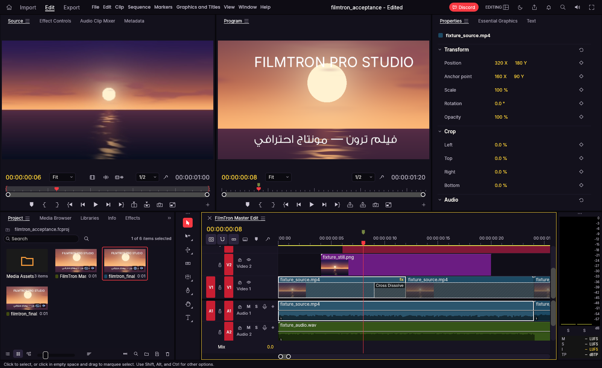
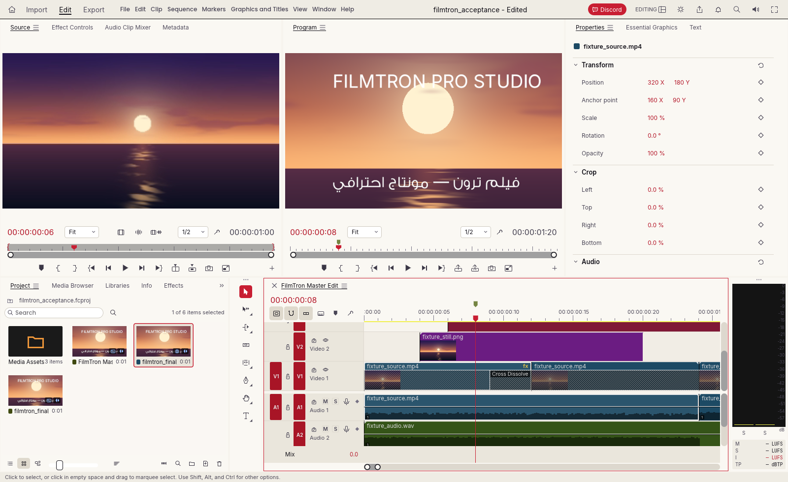
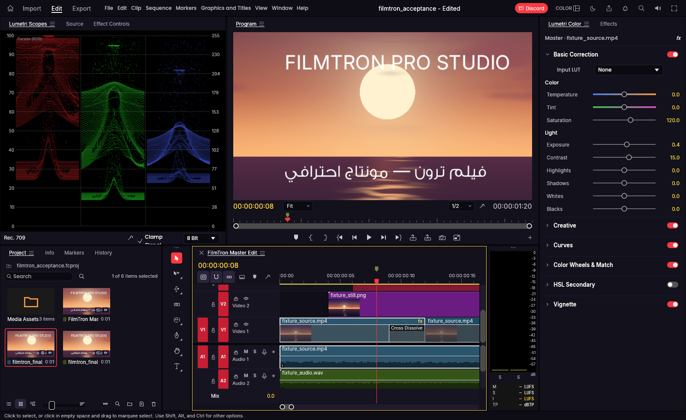
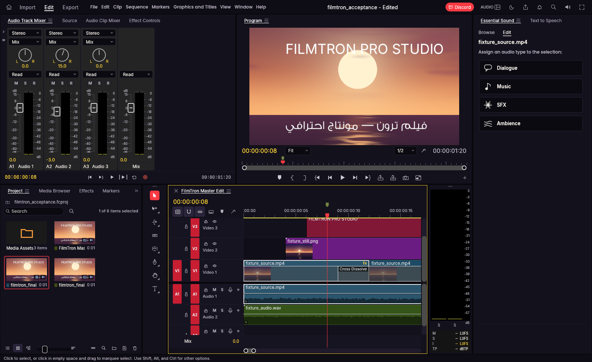
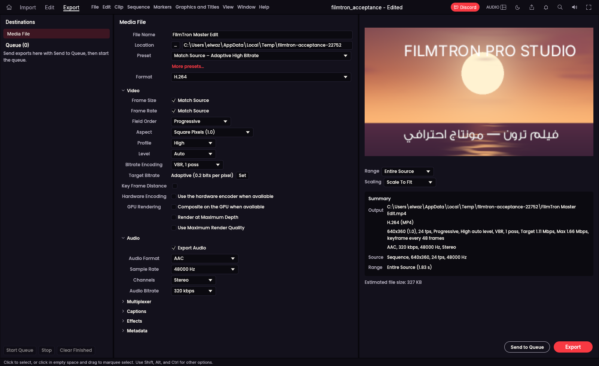
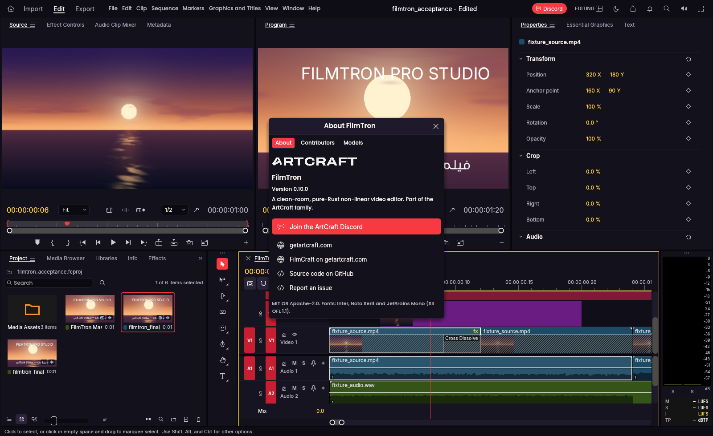
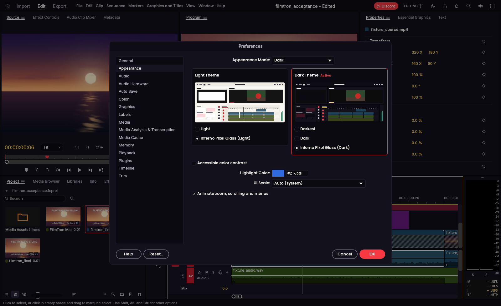

# FilmTron — Native Professional Nonlinear Video Editor

**FilmTron** (`Elwazeery/FilmTron`) is a standalone, native Premiere Pro-class nonlinear video editor, Lumetri color grading & scopes suite, multitrack audio/DSP workstation, and captioning/graphics tool built in pure Rust (`wgpu` + `egui` + `cpal`) on top of [`storytold/filmcraft`](https://github.com/storytold/filmcraft) (`cdf43fd366e378da266cb6d3c94549a45244be1f`, full Git ancestry and dual `MIT OR Apache-2.0` licensing preserved).

---

## 1. Platform Integration & Standalone Architecture

FilmTron operates as a fully independent desktop application while integrating cleanly with the GemiTron ecosystem:

- **GemiTokens & Inferno Pixel Glass UI (`crates/ui-egui/src/theme.rs`)**:
  - **Inferno Pixel Glass (Dark)** (default) and **Inferno Pixel Glass (Light)** themes engineered with `#09080E` / `#F4F3F8` canvas backgrounds, `#13111C` / `#FAF9FC` panel surfaces, and `#F97316` / `#EF4444` / `#F59E0B` warm-ember accents.
  - **Strict Color-Neutral Monitors & Scopes**: Source/Program monitors (`monitor_bg = RGB(24, 24, 24)`) and Lumetri video scopes (`plot_bg`, `scopes.rs`) remain strictly neutral (`R == G == B`) in every theme so user footage and grading decisions are never tinted by UI branding.
  - **Typography & RTL (`GemiFontSans`)**: Bundles `GemiFontSans-Light.ttf` (`300`), `GemiFontSans-Medium.ttf` (`500`), and `GemiFontSans-Bold.ttf` (`700`) (`OFL-1.1`, `assets/fonts/OFL-GemiFontSans.txt`) in `crates/text/src/fonts.rs` (`GEMI_BUNDLED`) and exposes `Tokens::font_sans()`, `Tokens::font_id()`, `Tokens::medium_font_id()`, and `Tokens::bold_font_id()` in `crates/ui-egui/src/theme.rs`, alongside `Inter`, `JetBrains Mono`, and optional `GEMI_FONTS_DIR` / `D:\GemiTron\GemiFonts\fonts\GemiFontSans\ttf` discovery, with full Unicode Bidirectional Algorithm (`unicode-bidi`) and HarfBuzz (`harfrust`) Arabic contextual shaping (`crates/ui-egui/src/rtl.rs`).
- **Authenticated Local Control Channel (`crates/automation/src/security.rs`)**:
  - Per-launch 256-bit CSPRNG 64-hex token (`generate_token`), mandatory pre-dispatch `{"method": "auth", "params": {"token": "..."}}` handshake (`AUTH_REQUIRED`), constant-time SHA-256 verification (`token_matches`), 10s auth deadline, 30s I/O timeout, 1 MiB line cap, 16-connection cap, loopback-only bind validation, Windows `icacls` DACL hardening + SDDL verification, and `AuthorizedWorkspace` root confinement (`FILMTRON_ALLOWED_ROOTS`).
- **Cloud GemiMCP Parity (`crates/automation/src/gemimcp.rs`, [`contracts/gemimcp-product-filmtron.v1.json`](contracts/gemimcp-product-filmtron.v1.json))**:
  - `GemiTron88/GemiMCP` is the sole cloud MCP runtime owner (`wss://mcp.gemitron.net/v1/bridge/filmtron`, `outbound_only: true`, `no_public_local_listeners: true`).
  - Exposes **32 semantic `film.*` tools** across all editing capability families plus **100% 1:1 native command coverage** (`295` `film.cmd.*` tools = `327` total tools) for every command in `filmcraft_engine::command_specs()`, guarded by `filmtron:read`, `filmtron:edit`, `filmtron:render`, `filmtron:ui`, and `filmtron:admin` scopes, `expectedRevision` optimistic concurrency fences (`REVISION_CONFLICT`), and `idempotencyKey` deduplication (`IDEMPOTENCY_CONFLICT` / `idempotentReplay`).
- **Gemi Access OIDC PKCE & GemiGuard Offline Entitlements (`crates/automation/src/gemiguard.rs`)**:
  - RFC 7636 `S256` PKCE challenge generator (`auth.gemitron.net`, `client_id = "filmtron-desktop"`) and pure-Rust FIPS 180-4 SHA-512 + RFC 8032 Ed25519 signature verification (`OfflineLease`, `RevocationList`).
  - Expired or revoked leases disable cloud MCP bridge execution (`cloud_mcp_allowed = false`) while preserving 100% local offline `.fcproj` editing and export (`local_editing_allowed = true`, `preserve_user_project_data = true`).

---

## 2. Screen-by-Screen Visual Audit (`wgpu` Native Renders)

| Workspace / View | Screenshot |
|---|---|
| **Editing Workspace — Inferno Pixel Glass (Dark)** |  |
| **Editing Workspace — Inferno Pixel Glass (Light)** |  |
| **Color Workspace — Lumetri Color & Neutral Scopes** |  |
| **Audio Workspace — Track Mixer, Meters & Essential Sound** |  |
| **Export Workspace — H.264/AAC Presets & Queue** |  |
| **About FilmTron Modal** |  |
| **Settings ▸ Appearance Modal** |  |

---

## 3. Canonical Documentation & Verification

- [Product & Complete MCP Parity Charter](docs/01-FORK-PRODUCT-AND-CLOUD-MCP-CHARTER.md)
- [Source Completeness & Parity Matrix (`L0`–`L6`)](docs/implementation/08-SOURCE-COMPLETENESS-AND-PARITY-MATRIX.md)
- [Native Control, GemiMCP Parity & Security Audit](docs/implementation/07-NATIVE-CONTROL-AND-MCP-SECURITY-AUDIT.md)
- [GemiMCP Product Manifest Contract (`v1`)](contracts/gemimcp-product-filmtron.v1.json)
- [Execution Task Backlog & Receipts](TODO.md)
- [Original Upstream README](docs/upstream/ORIGINAL-README.md) & [Upstream Import Record](docs/upstream/IMPORT-RECORD.txt)
- [Asset Attribution Index](ATTRIBUTION.md)

## 2026-10-21 — TRON optional local creative AI: design intake only

**Scope amendment (owner-approved; implementation NOT STARTED):** [TRON hybrid design](docs/creative-ai/TRON-LOCAL-CREATIVE-INTEGRATION-20261021.md); [TRON Egyptian Gen Z persona/training](https://github.com/GemiTron88/GemiMCP/blob/main/docs/creative-ai/TRON-PERSONA-AND-TRAINING-STRATEGY.v1.md); [shared creative rules](https://github.com/GemiTron88/GemiMCP/blob/main/docs/creative-ai/CREATIVE-KNOWLEDGE-AND-WORKFLOWS.v1.md); [optional ChatGPT->TRON delegation](https://github.com/GemiTron88/GemiMCP/blob/main/contracts/CREATIVE-AI-DELEGATION.v1.md). This specifically amends older no-local-AI statements while retaining ChatGPT-first, independent native editors, ONLY GemiMCP cloud MCP server, Gemi Access/GemiGuard, no paid model API and no mandatory downloads. One shared AI runtime, Qwen3.5-4B quant **candidate for inference** only; no Qwen3.5-4B/6GB-QLoRA feasibility claim. Closing last tab/job lease unloads GPU weights; other app leases must not be interrupted. **No model installed, trained, measured or deployed from this change.**
